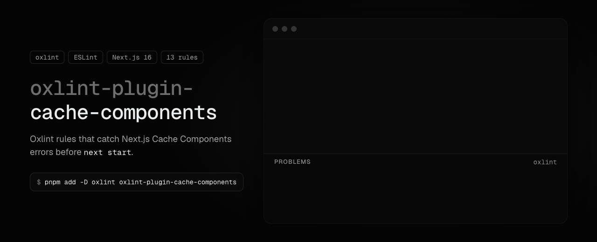

<p align="center">
  
</p>

<p align="center">
  <a href="https://www.npmjs.com/package/oxlint-plugin-cache-components"></a>
  <a href="https://github.com/galfrevn/oxlint-plugin-cache-components/actions/workflows/ci.yml"></a>
  <a href="https://github.com/galfrevn/oxlint-plugin-cache-components/actions/workflows/codeql.yml"></a>
  <a href="https://www.npmjs.com/package/oxlint-plugin-cache-components#provenance"></a>
  <a href="LICENSE"></a>
  <br />
  <a href="#manual-installation"></a>
  <a href="#manual-installation"></a>
  <a href="conformance/RESULTS.md"></a>
  <a href="#manual-installation"></a>
</p>

Oxlint rules that catch Next.js Cache Components errors before `next start`.

Next.js validates `"use cache"`, `cacheLife()`, `cacheTag()`, `revalidateTag()`, `updateTag()`, and `refresh()` at runtime. Reading `cookies()` inside a cached function passes `next build` on a dynamic route and fails under `next start`. `revalidatePath("/blog/[slug]")` without a type does nothing and only logs a warning. These rules report the same mistakes in the editor, in CI, and in the coding agent's loop. Each message names the function, explains the constraint, gives the fix, and links the Next.js docs page.

The plugin is oxlint-first and also runs in ESLint. It is a community project, not affiliated with Vercel.

## Install with an agent skill

```bash
npx skills add galfrevn/oxlint-plugin-cache-components --skill install-cache-components
```

Then ask your coding agent to install oxlint-plugin-cache-components in the current repository. The skill installs the packages with the repository's package manager, merges the `recommended` preset into the existing oxlint or ESLint configuration, offers a post-edit hook that lints each file the agent changes, and runs the linter once. It reports the findings and does not fix them automatically.

## Manual installation

```bash
pnpm add -D oxlint oxlint-plugin-cache-components
```

Extend the `recommended` preset in `oxlint.config.ts`:

```ts
import { defineConfig } from "oxlint";
import cacheComponents from "oxlint-plugin-cache-components/configs";

export default defineConfig({
  extends: [cacheComponents.recommended],
});
```

Or register the plugin in `.oxlintrc.json`:

```json
{
  "jsPlugins": ["oxlint-plugin-cache-components"],
  "rules": {
    "cache-components/no-request-api-in-cache": "error",
    "cache-components/no-cache-api-outside-cache": "error",
    "cache-components/require-cachelife-when-nested": "error",
    "cache-components/no-invalid-cache-nesting": "error",
    "cache-components/valid-invalidation-context": "error",
    "cache-components/no-promise-args-to-cache": "error",
    "cache-components/require-revalidate-tag-profile": "warn",
    "cache-components/require-revalidate-path-type": "warn",
    "cache-components/require-auth-before-revalidate": "warn"
  }
}
```

With ESLint 9 or later, use the flat config:

```js
import cacheComponents from "oxlint-plugin-cache-components";

export default [cacheComponents.configs["flat/recommended"]];
```

The plugin needs oxlint 1.63.0 or later and Node.js `^20.19.0 || >=22.12.0`. `oxlint.config.ts` needs Node.js 22.18 or later, and a `package.json` with `"type": "module"` to avoid a Node.js warning on every run. Use `.oxlintrc.json` otherwise.

### Presets

| Preset | oxlint | ESLint | Severity |
|---|---|---|---|
| `recommended` | `cacheComponents.recommended` | `configs["flat/recommended"]` | `error` for rules that map to a Next.js error, `warn` for deprecations, no-ops, and the auth heuristic |
| `strict` | `cacheComponents.strict` | `configs["flat/strict"]` | the `recommended` rules as `error`, plus the serialization and `React.cache` heuristics as `warn` |
| `migration` | `cacheComponents.migration` | `configs["flat/migration"]` | `no-legacy-segment-config` as `error`, for projects that enable `cacheComponents` |
| `all` | `cacheComponents.all` | `configs["flat/all"]` | every rule as `error`. `no-legacy-segment-config` reports nothing unless you also extend `migration` |

Combine `migration` with another preset while you move a project to Cache Components:

```ts
export default defineConfig({
  extends: [cacheComponents.recommended, cacheComponents.migration],
});
```

### Shared settings

Options that several rules read can be set once. A rule option takes precedence over the shared setting.

```json
{
  "settings": {
    "cache-components": {
      "requestApis": ["next-auth:auth", "@/lib/session:getSessionOfCurrentRequest"],
      "appDir": ["apps/web/app"],
      "shortProfiles": ["realtime"],
      "authFunctions": ["assertAdmin"],
      "authWrappers": ["adminAction"]
    }
  }
}
```

- `requestApis`: functions that read cookies or headers, treated like `cookies()`. They can come from an auth library or be your own helpers imported from another file, since the rules do not follow imports. `"auth"` matches an import named `auth` from any module, and `"next-auth:auth"` matches only that module. The module must match the import source as written, such as `@/lib/session` or `#lib/session.ts`. Use the name alone when files import the helper through different paths.
- `appDir`: App Router directories, matched against the file path relative to where the linter runs. The default is `["app", "src/app"]`.
- `shortProfiles`: custom `cacheLife` profiles from `next.config` whose `expire` is under 5 minutes or whose `revalidate` is `0`.
- `authFunctions` and `authWrappers`: auth helpers and wrappers for `require-auth-before-revalidate`, added to its defaults.

## Rules

Each rule has a page in [`docs/rules`](docs/rules) with its examples, options, and limitations.

| Rule | What it reports | Preset |
|---|---|---|
| [`no-request-api-in-cache`](docs/rules/no-request-api-in-cache.md) | `cookies()`, `headers()`, `connection()`, `searchParams`, `draftMode()` mutations, or Route Handler `request` reads inside a cache scope, including through helpers in the same file. | error |
| [`no-cache-api-outside-cache`](docs/rules/no-cache-api-outside-cache.md) | `cacheTag()` or `cacheLife()` where no `"use cache"` scope exists: module scope, Server Actions, Route Handlers, Client Components, and `unstable_cache()` callbacks. | error |
| [`require-cachelife-when-nested`](docs/rules/require-cachelife-when-nested.md) | A cached function without `cacheLife()` that calls or renders a short-lived cached function, which fails during prerender. | error |
| [`no-invalid-cache-nesting`](docs/rules/no-invalid-cache-nesting.md) | `"use cache: private"` inside a public cache, inside `unstable_cache()`, or reached from `generateStaticParams`. | error |
| [`valid-invalidation-context`](docs/rules/valid-invalidation-context.md) | `revalidateTag()`, `revalidatePath()`, `updateTag()`, or `refresh()` in a cached function, during render, in a build-time generator, in Proxy, in a Client Component, or `updateTag()` and `refresh()` outside a Server Action. | error |
| [`no-promise-args-to-cache`](docs/rules/no-promise-args-to-cache.md) | `cookies()`, `headers()`, or a captured request promise passed to a cached function without `await`, which hangs the build for about 50 seconds. | error |
| [`require-revalidate-tag-profile`](docs/rules/require-revalidate-tag-profile.md) | `revalidateTag(tag)` with one argument, which Next.js deprecates. | warn |
| [`require-revalidate-path-type`](docs/rules/require-revalidate-path-type.md) | `revalidatePath()` with a dynamic route and no `type`, which does nothing. | warn |
| [`require-auth-before-revalidate`](docs/rules/require-auth-before-revalidate.md) | Cache invalidation in a Server Action or Route Handler with no auth check, secret check, or rate limit on every path before it. | warn |
| [`no-legacy-segment-config`](docs/rules/no-legacy-segment-config.md) | `dynamic`, `revalidate`, `fetchCache`, `runtime`, or `experimental_ppr` exported from a segment, which fails the build with Cache Components. | `migration` |
| [`no-introspect-passthrough`](docs/rules/no-introspect-passthrough.md) | Reading `children` or calling a function received as an argument inside a cached function. | `strict` (warn) |
| [`serializable-cache-args`](docs/rules/serializable-cache-args.md) | Class instances, symbols, `URL`, `WeakMap`, `WeakSet`, or the request passed to a cached function. | `strict` (warn) |
| [`no-react-cache-across-boundary`](docs/rules/no-react-cache-across-boundary.md) | A `React.cache` function called both outside and inside a cached function, where its result is not shared. | `strict` (warn) |

The rules in `recommended` and `migration` map to an error or warning that Next.js already produces, except `require-auth-before-revalidate`, a heuristic based on the Next.js data security guide that ships as `warn`. The `strict` heuristics read the code without types, so they ship as warnings.

### Analysis boundaries

The rules analyze one file at a time. They resolve Next.js APIs by following the import binding from `next/headers`, `next/server`, `next/cache`, or `react`, so renamed imports, namespace imports, and `const` aliases such as `const read = cookies` are recognized, and a local variable with the same name is not. They follow calls and JSX between functions in the same file. A helper imported from another file is not followed, and a function whose context the file cannot prove, such as an exported helper with no callers in the file, is not reported. The rules do not use type information.

Each rule is confirmed against a real Next.js 16.4.6 app with `next build` and `next start`: see [`conformance/RESULTS.md`](conformance/RESULTS.md). The false-positive review on 61 public repositories that use Cache Components is in [`scripts/corpus/triage.md`](scripts/corpus/triage.md).

## Violation examples

Each snippet below is reported by the named rule.

### `no-request-api-in-cache`

```tsx
import { cookies } from "next/headers";

async function getTheme() {
  return (await cookies()).get("theme")?.value;
}

export async function Header() {
  "use cache";
  const theme = await getTheme();
  return <header data-theme={theme} />;
}
```

```text
`getTheme()` reads `cookies()` (line 4), and it's called inside "use cache" function `Header`. Read the value outside the cached function and pass it as an argument. See https://nextjs.org/docs/messages/next-request-in-use-cache
```

Read the value in the uncached caller and pass it as an argument, or switch the function to `"use cache: private"`.

### `no-cache-api-outside-cache`

```ts
"use server";
import { cacheTag } from "next/cache";

export async function savePost(id: string) {
  cacheTag(`post-${id}`);
}
```

### `require-cachelife-when-nested`

```tsx
import { cacheLife } from "next/cache";

async function StockTicker() {
  "use cache";
  cacheLife("seconds");
  return <span>{await getPrice()}</span>;
}

export default async function ProductPage() {
  "use cache";
  return <StockTicker />;
}
```

The rule suggests adding `cacheLife("seconds")` to keep the page dynamic, or `cacheLife("minutes")` to prerender it.

### `no-invalid-cache-nesting`

```tsx
async function Recommendations() {
  "use cache: private";
  const user = (await cookies()).get("uid");
  return <List items={await recommend(user)} />;
}

export default async function Page() {
  "use cache";
  return <Recommendations />;
}
```

### `valid-invalidation-context`

```ts
// app/api/posts/route.ts
import { updateTag } from "next/cache";

export async function POST() {
  updateTag("posts");
  return Response.json({ ok: true });
}
```

The rule suggests `revalidateTag("posts", { expire: 0 })`, which keeps the immediate expiration in a Route Handler.

### `no-promise-args-to-cache`

```tsx
import { cookies } from "next/headers";

export default function Page() {
  return <Prefs store={cookies()} />;
}

async function Prefs({ store }: { store: ReturnType<typeof cookies> }) {
  "use cache";
  return <p>{(await store).get("theme")?.value}</p>;
}
```

### `require-revalidate-tag-profile`

```ts
revalidateTag("posts");
```

The rule suggests `revalidateTag("posts", { expire: 0 })` to keep the current behavior, `revalidateTag("posts", "max")` for stale-while-revalidate, and `updateTag("posts")` inside a Server Action.

### `require-revalidate-path-type`

```ts
revalidatePath("/blog/[slug]");
```

### `require-auth-before-revalidate`

```ts
"use server";
import { updateTag } from "next/cache";

export async function deletePost(id: string) {
  await db.posts.delete({ where: { id } });
  updateTag("posts");
}
```

## Use with coding agents

The messages are written for agents as well as people, and they work with every oxlint output format, including `--format agent`. The [hook recipes](skills/install-cache-components/references/hooks.md) lint each file after the agent edits it and return the findings to the agent, with a warn variant and a block variant for Claude Code.

## Development

```bash
pnpm install
pnpm check
```

`pnpm check` runs oxfmt, oxlint, the TypeScript checker, every `RuleTester` suite, and the end-to-end tests, which build the package and lint a fixture app with the oxlint CLI and with ESLint. Other scripts:

- `pnpm build`: builds `dist/` with tsdown, and checks the package with publint and Are the Types Wrong.
- `pnpm corpus --limit 60`: clones public repositories from [`scripts/corpus/repositories.tsv`](scripts/corpus/repositories.tsv) with `git clone --depth 1`, lints them with the `all` and `migration` presets, and writes the findings to `scripts/corpus/results/`. It does not install dependencies or run code from those repositories.
- `pnpm next-sync`: compares the Next.js error sources on `canary` with the snapshot in `scripts/next-sync/snapshot/`.
- `pnpm conformance`: builds each case in `conformance/cases/` with Next.js, requests it when needed, and checks that Next.js fails as expected and that the plugin reports the matching rule.

Read [CONTRIBUTING.md](CONTRIBUTING.md) before you open an issue or a pull request, and [SECURITY.md](SECURITY.md) to report a vulnerability.

## License

[MIT](LICENSE). Rule messages are adapted from Next.js, which is also MIT licensed. See [THIRD_PARTY_NOTICES.md](THIRD_PARTY_NOTICES.md).
